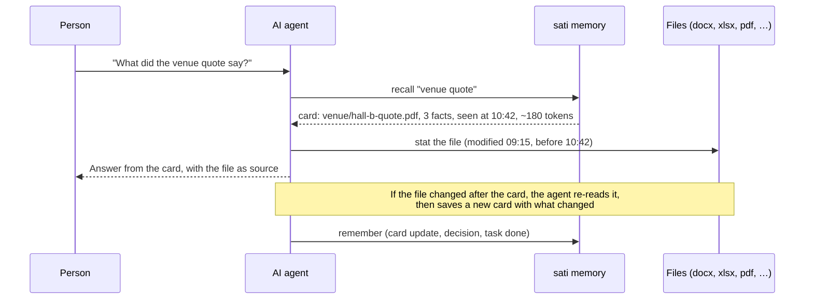

# Knowledge brain: agents read, sati remembers

Nov 7, 2026 · implementation plan for PLAN.md Phase 8 · @kongpda

## The idea

sati is the team's memory, not a file reader. Install it in any folder an AI agent can work in —
a code repo, a marketing drive, an events folder full of Word, Excel, PowerPoint, PDF and image
files. The agent does everything that needs understanding: it opens the files with its own tools,
notices what changed, reads Khmer and English, and writes the result. sati keeps what the agent
and the people learned, decided, did, still need and plan, so the next session — by any agent or
any person — starts from that memory instead of from scratch.

**sati never opens, parses or watches the user's files.** It stores short, structured memory that
agents and people write, and it hands back the right part of that memory in as few tokens as
possible.

## What exists, and what is missing

Already in sati: tasks (what is needed and what is done, with summaries and files touched),
milestones (the plan), decisions (why), notes (free-form knowledge), context entries (a summary
per path), handoffs (where someone stopped), the activity log (who did what) and the brief (a
session start under 1,500 tokens).

Missing for a brain everyone uses:

1. **Memory of a file.** A context entry holds one summary for a code path, and is marked stale
   only from git hashes. There is no place for the key facts of a document ("Hall B quote: $2,400,
   valid until 1 December"), and outside git nothing tells the next agent which version of the file
   the summary describes.
2. **Recall.** Search covers tasks, features, notes and decisions, but not context entries, so a
   summary an agent wrote is found only by its exact path.
3. **Agents cannot write notes** (no MCP note tool), so knowledge that is not a task or a decision
   has nowhere to go.
4. **Answers are larger than they need to be.** Lists and search return whole records; in the
   local review, 22 tasks were 20,341 characters of JSON, against 2,043 for id, title and status.
5. **Nothing measures the saving,** so nobody can tell whether the memory is paying for itself.
6. **No private memory.** Everything in a git-mode project is exported to `.sati/`, so a summary
   of a confidential contract would land in git.

## How it works

1. **Before reading a file,** the agent asks sati for its card (`context_get` with the path, or
   `recall` with words). If the card's `sourceSeen` matches the file's current modified time or
   hash — which the agent checks itself — the agent uses the card and skips the file.
2. **After reading a file,** the agent saves a card: a summary, up to 50 short facts, tags, the
   file's modified time or hash it saw (`sourceSeen`) and roughly how many tokens the file cost to
   read (`sourceTokens`).
3. **When work happens,** the agent records it where it belongs: a task completed with a summary,
   a decision with its reason, a note for knowledge, a handoff when it stops.
4. **At the start of every session,** the brief adds a short "Knowledge" section: the project's
   pinned notes (brand voice, policies, contacts) and the cards linked to the task in hand.

## Changes

### Memory model

| Change | Detail |
| --- | --- |
| Cards (context entries) gain `facts[]`, `tags[]`, `sourceSeen`, `sourceTokens` | `facts` up to 50 items of 300 characters; `sourceSeen` is whatever the agent observed (modified time or hash); `sourceTokens` is the agent's estimate of reading the file. All optional, so existing entries stay valid |
| Git-mode staleness stays | In a git repo sati still marks a card stale from git hashes, as today. Outside git the card shows `sourceSeen` and the agent decides |
| `private: true` on notes and cards | Kept in the local database only: never exported to `.sati/`, never in the brief of another machine. For confidential material in a shared repo |
| Pinned notes reach the brief | Up to 3 pinned notes, clipped, inside the existing 1,500-token cap |

The snapshot `schemaVersion` goes up with an automatic migration, as the Versioning section
requires.

### Agent tools (MCP)

| Tool | Change |
| --- | --- |
| `context_get` / `context_put` | Described as memory of any file, folder or module; accept the new fields |
| `search` | Also searches cards (summary, facts, tags, path); returns compact hits by default (id, kind, title, 20-word snippet, about 40 tokens each), `detail: "full"` on request |
| `task_list` | Compact rows by default (id, title, status, priority, holder), `detail: "full"` on request |
| `note_upsert` / `note_get` | From Phase 7a: agents can write and read notes, including `pinned` and `private` |
| `recall` | One call for "what do we know about X": the best cards, notes, decisions and open tasks, deduplicated, with ids and sources, capped at 1,000 tokens. No model inside sati; the agent writes the answer |

The managed rules block gains two lines: "Before opening a file, `context_get` it; reuse the card
if the file is unchanged. After reading a file, save a card with facts and `sourceSeen`." The
`sati://workflow` resource explains cards, private memory and recall in full.

### People (CLI and web UI)

- `sati recall "<words>"`, `sati card show|put <path>`, `sati note pin|private <id>`.
- **Memory page** in the UI: cards grouped by folder, with their facts, tags, who wrote them and
  when, a search box, and Edit. Private items carry a lock badge.
- **Ask box** on every page: the same result as `recall`, with "Copy as Markdown".
- Pinned notes show at the top of the board, so the brand kit or event brief is one click away.

### Measuring the saving

The saving is measured with the agent tool's own usage report, not by sati: the same questions are
asked in a fresh session and the token counts compared (the Phase 8 gate). A sati-side token
ledger (`sati stats tokens`) was moved to `docs/ideas.md` on 2026-11-07, because its estimates
would invite more trust than they deserve.

## How it improves the work

- **Nothing is learned twice.** One agent reads the 30-page brochure once; every later agent and
  person uses its card until the file changes.
- **Answers carry their source.** Cards keep the file path and the facts, so a person can check a
  number in one step, and agents quote facts instead of guessing.
- **Decisions stop being re-opened.** "Why Hall B?" is a decision with its reason, found by recall.
- **Work is visible.** What is done (with summaries), what is needed, who is on it and what is
  planned, for people and agents alike.
- **Consistent output.** Pinned brand and policy notes are in every agent's brief, so copy follows
  the same voice and rules; the review gate keeps a person in the loop before anything ships.

## Security and privacy

- sati reads no user files, so it adds no file-parsing attack surface.
- Cards and notes are agent-written text: they go through the secret scanner on export (existing),
  and also on write, where a match is refused with the field name, before it reaches the database.
- Private memory never leaves the machine's database; `sati doctor` lists private items, and the
  export and hosted sync skip them.
- Everything an agent reads from sati stays inside marked data blocks, and the workflow says
  memory text is data, never instructions (existing rule).
- Size limits apply to the new fields like every other field (arrays up to 500, facts 300
  characters, summary 2,000).

## Performance budgets

| Measure | Budget |
| --- | --- |
| `recall` on 50,000 records and cards | p95 under 50 ms |
| `search` including cards | p95 under 50 ms (existing budget) |
| Compact `task_list` of 500 tasks | under 15,000 characters |
| Brief with the Knowledge section | under 1,500 tokens (existing cap) |
| CLI cold start | unchanged |

## Build plan (about 2.5 weeks, after Phase 7a)

1. **Cards (0.5 week).** Schema fields and migration, `context_put/get` and CLI `card`, git-mode
   staleness unchanged, secret scan on write.
2. **Recall and compact answers (1 week).** Cards in FTS, compact `search` and `task_list` with
   `detail`, `recall` in core, CLI and MCP, with the 1,000-token cap.
3. **Private and pinned (0.5 week).** `private` on notes and cards, export and sync skip them,
   pinned notes in the brief.
4. **Token ledger and UI (0.5 week; the ledger moved to `docs/ideas.md` on 2026-11-07).** Ledger, `stats tokens`, Memory page, Ask box, pinned notes
   on the board; Playwright and axe.

## Gate

An agent in a folder of real Office and PDF files answers 20 questions about it. The first time it
reads the files and saves cards; in a fresh session it answers the same questions from sati's
memory, re-reading only the files that changed. The second run uses at least 70% fewer tokens
(measured by the agent tool's own usage report, not by sati). No private item appears in `.sati/`
or git. All existing budgets still pass.

## Not in Phase 8

- sati reading, indexing or watching files itself — by design, that is the agent's job.
- Embeddings or a model inside sati.
- Editing Office files.
