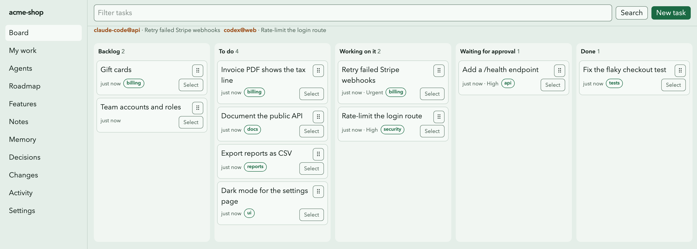

# sati

**Shared memory and traffic control for AI coding agents.**

Run Claude Code, Codex, Cursor and Gemini CLI in the same repository at the same time. sati gives
them one list of tasks, one record of decisions and one set of rules, so they do not take the
same task, edit each other's files or delete code that already ships.



- **Tasks with claims**: an agent claims a task before it codes; nobody else can take it.
- **A brief, not a crawl**: `sati brief` gives an agent its task, the ready queue and what changed
  since its last session.
- **Protected features**: the guard blocks deleting or gutting shipped code, in the editor, in git
  hooks and in CI.
- **Path locks, decisions and file cards**, so agents do not collide or repeat work.
- **People in the loop**: agents' finished work waits for a person to approve.
- **A local web board** (`sati ui`), and the same operations over MCP and the CLI (`--json`).
- **Local-first**: SQLite on your machine. In git mode a `.sati/` JSON snapshot is committed and
  merged by a git merge driver.

## Install

Node.js 24.15 or newer:

```bash
cd my-project
npm install -D @kongpda/sati   # or: pnpm add -D, yarn add -D
npx sati init
```

`init` asks for a mode (`git`, `stealth` for client repos, or `standalone` outside git) and the
agent tools to set up: Claude Code, Codex, Cursor, Gemini CLI, Copilot, Windsurf, Cline or Kiro.
It writes the MCP config, a rules block in `AGENTS.md`, editor hooks and git hooks. They start
`node_modules/.bin/sati`, so every teammate gets the version in the lockfile.

For stealth mode or a folder without a `package.json`: `npm install -g @kongpda/sati`, then
`sati init`.

## Use

```bash
sati task create "Add a /health endpoint"
sati next           # claim the top ready task
sati brief          # what an agent sees at session start
sati ui             # the web board
sati doctor         # health checks
```

Agents call the MCP tools instead (`sati_brief`, `task_claim`, `feature_check`,
`task_complete` and others). Any MCP client can run `sati mcp` over stdio.

## Docs

- [README with the full overview](https://github.com/kongpda/sati#readme)
- [Quick start](https://github.com/kongpda/sati/blob/main/docs/guide/quick-start.md)
- [Agent workflow](https://github.com/kongpda/sati/blob/main/docs/guide/agent-workflow.md) ([general projects](https://github.com/kongpda/sati/blob/main/docs/guide/agent-workflow-general.md))
- [Guard rules](https://github.com/kongpda/sati/blob/main/docs/guide/guard.md)
- [FAQ](https://github.com/kongpda/sati/blob/main/docs/guide/faq.md)
- [Glossary](https://github.com/kongpda/sati/blob/main/docs/guide/glossary.md)

## License

MIT. The package also bundles third-party code; their licenses are in `dist/THIRD_PARTY_LICENSES.md` and `dist/ui/licenses.md`.
